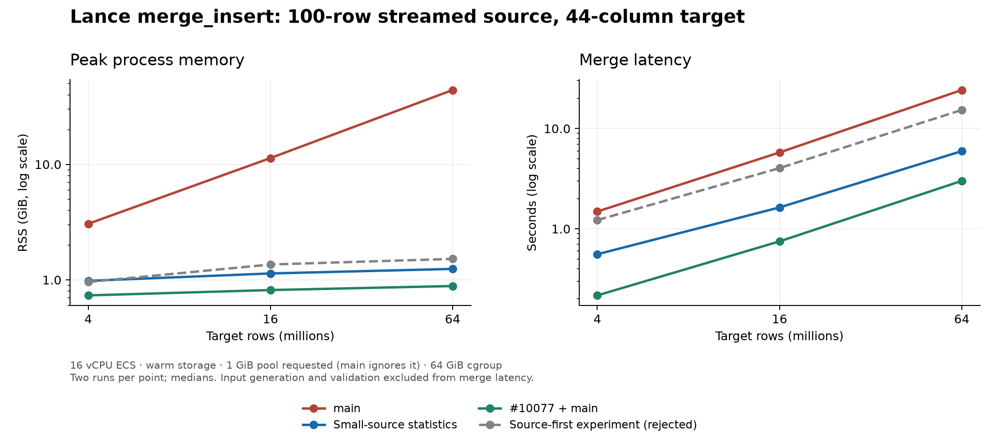

# Lance #9505：实现与验证结论

已在 ECS 独立 worktree 完成研究、两个方案的实现对照、回归、优化构建和性能测试。最终保留的小流统计方案能够解决本研究复现的主要场景：小 reader、巨大 target、非索引、稀疏部分列 RewriteRows。64M 行测试的峰值 RSS 降低 **97.2%**，merge 加速 **4.07 倍**。这不是原报告私有数据集的直接重放，也不是整个 merge_insert 的进程内存上限保证。

候选有独立提交价值，适合定位为“小流 source 统计缺失修复”，不宜声称完全替代 #10077 或覆盖所有 OOM。极宽单元格仍有反例；若 #9505 的验收要求涵盖任意 payload 和统一 RSS 限额，本候选尚不足以完成这个更大目标，#10077 在本次 2 GiB cgroup 测试中也未全部通过。未创建 GitHub PR，未发表上游评论。

## 代码与验证对象

- 上游 main：dc53d5d174af62c49ddd98d1024a64488c1e4404，2026-10-18 交付前再次查询仍为该 revision。
- 最终本地提交：793e4e27119540a17ae37ce78d4f5f4d52060a93。
- 云端分支：fix/9505-small-stream-statistics；worktree：/mnt/lance/issue-9505/statistics。
- #10077 head：9e1ebc2e816a7195b56757ebe269e74989fc30c7，仍 open；比较对象为它与当前 main 的干净合并结果 f8859373d5022eedea239db2fcfd68713a423762。
- 修改 3 个文件，328 additions / 87 deletions，包含回归、计划断言和文档调整。[提交补丁](patches/small-stream-statistics.patch)；[实现源码](../../rust/lance/src/dataset/write/merge_insert.rs)。
- 原有本机与云端 #7895/#9617 checkout 未修改。基线 main、#10077 合并 worktree 和候选 worktree 收尾时均无跟踪文件改动。

## 根因、实现选择与边界

[#9505](https://github.com/lance-format/lance/issues/9505)报告约 81.6M 行、44 列、100 行 source，仅更新两个字段。调用者当时用 use_index=false 获得行重写，不能据此把 indexed merge 当作替代验收。完整字段类型和原始数据未提供。主要证据、维护者评论、历史 PR 与方案比较见 [DESIGN.md](DESIGN.md)。

调用链是 Python 输入分类 → PyO3 execute_batches/execute → Rust provider 准备与 retry → 非索引 create_plan → DataFusion JoinSelection → HashJoinExec → merge 写入算子。materialized 输入已有 MemTable 统计；reader 及其重试 spill 仍是未知统计的 StreamingTable。target 较大时，优化器保留 target build。部分列行重写还必须带上旧字段，造成内存随 target 增长。main 的实际执行上下文没有启用 Lance 的有界池。

4M 行诊断计划证实：main 构建 4M target 行，HashJoin 的 build_mem_used 约 1.57 GB；候选构建 100 source 行，约 4.70 KB。两者都扫描 4M target 行。候选保留 16 个输出分区，#10077 在该计划中为单 probe 分区。诊断计划只证明算子行为；成功结论来自实际 execute 及读回验证。

候选在非索引入口有界预读：复用已有 100 MiB retry buffer 预算，并以 128 Ki 行限制预读和小输入 FirstSeen 去重工作量。只有遇到 EOF 才发布 MemTable 精确统计；超限时保留前缀和原流顺序，继续原有路径。单个调用者 batch 可以跨过阈值，因此这不是硬 RSS 上限。小输入 FirstSeen 按原分区顺序去重并保留统计；关闭 retry spilling 时仍保持冲突 fail-fast。实际执行、规划和 analyze 使用 Lance 有界上下文，不强制 join 顺序，不关闭 DataFusion 的 join/repartition 优化，不修改 indexed join、扫描器、解码器或写入策略实现。

仅加内存池不能让错误 build 选择成功；无界 drain source 会扩大启动屏障和驻留/落盘成本。实验 A 的 source-first 虽减少正向内存，却使 3M reader source 在 1 GiB 池失败，且 64M 正向耗时 15.332 秒，故已放弃。它的补丁和结果保留为[实验对照](patches/source-first-experiment.patch)。late materialization 的历史尝试涉及 take 顺序和随机 I/O；本研究没有实现它，不能给出其性能结论。

## 实测结果

正式矩阵共 160 次 execute，四个版本各 40 次：134 次成功并通过读回验证，16 次内存池不足，10 次由 journal 确认 OOM；诊断计划与早期调试运行不计入这些成功数。以下单元格为 **merge 秒数 / 峰值 RSS GiB**；普通场景是两次独立进程运行的中位数，每次成功都核验更新/插入/删除计数和读回结果。除另标外，请求 1 GiB 执行池。**main 的非索引路径忽略这个池配置**，它成功不代表遵守了池限额。cgroup 才是独立的进程组硬限额。

| 场景 / source | main | 本次候选 B | #10077 + main |
| --- | ---: | ---: | ---: |
| 4M × 44 列 / reader 100 行 | 1.487 / 3.057 | 0.558 / 0.981 | 0.217 / 0.733 |
| 16M × 44 列 / reader 100 行 | 5.778 / 11.340 | 1.635 / 1.136 | 0.750 / 0.816 |
| 64M × 44 列 / reader 100 行 | 24.241 / 44.045 | 5.957 / 1.243 | 3.007 / 0.884 |
| 4M × 44 列 / materialized 100 行 | 0.568 / 0.970 | 0.538 / 0.960 | 0.220 / 0.719 |
| 16M × 44 列 / materialized 100 行 | 1.687 / 1.119 | 1.561 / 1.178 | 0.751 / 0.798 |
| 64M × 44 列 / materialized 100 行 | 5.857 / 1.256 | 5.888 / 1.279 | 2.965 / 0.878 |
| 4M × 44 列 / reader 100K 行 | 1.502 / 3.128 | 1.312 / 0.981 | 0.344 / 0.753 |
| 4M × 44 列 / materialized 100K 行 | 1.271 / 0.990 | 1.273 / 1.018 | 0.347 / 0.766 |

| 64M target / reader 100 行 | 目标行吞吐 (M rows/s) | 平均使用 CPU 核数 |
| --- | ---: | ---: |
| main | 2.643 | 3.19 |
| 本次候选 B | 10.745 | 4.06 |
| #10077 + main | 21.287 | 6.77 |

CPU 核数是进程 CPU 秒数 / merge 墙钟秒数。#10077 的单 probe 分区仍可并行解码，本场景平均使用约 6.77 核，不能称其“只用一个 CPU”。本研究没有逐项禁用开关的消融实验，因此不把全部速度差异归因于某一个优化开关。

| 场景 / source | main | 本次候选 B | #10077 + main |
| --- | ---: | ---: | ---: |
| 100K target / reader 3M 全列 source；1 GiB 池 | 2.213 / 1.776 | 2.333 / 1.727 | 内存池不足 (2 次) |
| 100K target / materialized 3M 全列 source；1 GiB 池 | 1.496 / 3.120 | 1.423 / 3.193 | 内存池不足 (2 次) |
| 相同反向规模 / reader；8 GiB 池 | 1.987 / 1.920 | 1.842 / 1.868 | 4.658 / 3.459 |
| 相同反向规模 / materialized；8 GiB 池 | 1.368 / 2.935 | 1.290 / 2.776 | 2.785 / 4.298 |
| 2M target，payload 128 B–2 KiB / reader 100 行 | 3.715 / 6.507 | 2.142 / 1.781 | 1.802 / 1.767 |
| 同上 / materialized 100 行 | 1.995 / 1.871 | 2.083 / 1.899 | 1.791 / 1.749 |
| 400 × 5 MiB target / reader 25 行窄 source | 3.768 / 5.352 | 2.873 / 2.555 | 2.254 / 2.446 |
| 同上 / materialized 25 行窄 source | 2.475 / 2.467 | 2.787 / 2.705 | 2.243 / 2.447 |
| 400 × 5 MiB target / reader 25 × 10 MiB source | 4.624 / 6.041 | 内存池不足 (2 次) | 3.498 / 3.602 |
| 同上 / materialized 25 × 10 MiB source | 4.457 / 5.404 | 内存池不足 (2 次) | 2.973 / 3.597 |

普通变长列使用独立随机内容和均匀采样的 128 B–2 KiB 长度，20 个 fragments。5 MiB 单元格来自 #10077 的压力边界思路，不代表原报告字段大小。窄 source 只带 key 和两个整数；宽 source 带 key 和 25 个 10 MiB 替换值。反向规模输入为全列数据，实际更新 100K 行并插入 2.9M 行。

宽 source 的失败已核对为 HashJoinInput ResourcesExhausted。目标变长字段宽度统计可能严重低估，优化器会认为 target 更小；补齐 source 统计不能校正错误的 target 宽度。main 在这组 8 GiB cgroup 下成功但使用超过 5 GiB RSS，也没有执行请求的 1 GiB 池限制。

以下全部使用 **2 GiB cgroup，swap=0**。固定宽度用例两次，其余压力用例各一次；OOM 均由 systemd journal 的 oom-kill 记录确认。

| 场景 / source | main | 本次候选 B | #10077 + main |
| --- | ---: | ---: | ---: |
| 4M target / reader 100 行；256 MiB 池 | OOM (2 次) | 0.554 / 0.976 | 0.211 / 0.530 |
| 400 × 5 MiB target / reader 25 行窄 source；1 GiB 池 | OOM (1 次) | OOM (1 次) | OOM (1 次) |
| 400 × 5 MiB target / reader 25 × 10 MiB source；1 GiB 池 | OOM (1 次) | OOM (1 次) | OOM (1 次) |

这证明小流统计修复能解除主要复现的 target-build OOM，也证明它没有约束 scan、batch 合并、source 构造和 writer 的全部分配。DataFusion 54.1 HashJoin 不会自动落盘；池不足是资源错误。有关拼接暂存与 reservation 的源码证据见设计记录；没有做完整 heap allocation 归因。

materialized 与 reader 的输入准备成本不同。下面把输入生成/准备加回 merge，避免只比较 API 内部时间：

| 反向规模，8 GiB 池 | materialized：准备 + merge (秒) | reader：准备 + merge (秒) |
| --- | ---: | ---: |
| main | 2.250 | 2.003 |
| 本次候选 B | 2.152 | 1.858 |
| #10077 + main | 3.681 | 4.673 |

这不是包含数据集生成、restore、验证及 Python 启动的脚本总时间。固定小 source 的准备开销约亚毫秒；3M 全列 materialized source 的准备成本约 0.9 秒，reader 在调用中按需生成。

## 回归、复现与提交判断

最终冻结源码验证通过：

- Rust merge_insert 模块 **337 passed**，4.76 秒。覆盖已有 JoinType、matched/unmatched、部分列、NULL、FirstSeen、重复策略与冲突重试；新增跨 4 fragments 的 8 MiB pool 回归和超限前缀不丢行/不继续预读的检查。
- Python merge_insert **42 passed**，6.92 秒；计划文档 **2 passed**，0.10 秒。新增 materialized/reader 对照、空 reader、生成器中途错误、100K reader 获得统计及 200K reader 保留 streaming 的断言。
- 完整 workspace Clippy、cargo fmt、完整 Python make lint、提交前 Ruff/format/typos 等 hooks 全部通过。
- 优化 Python 构建使用仓库 release-with-debug，ThinLTO，16 codegen units；最终构建 14m35.80s，exit 0。提交后 SHA-256 与冻结源码一致。
- 保留中间失败及修复记录。曾有一次过时优化构建被主动取消；最终指标来自之后重新完成的构建，没有混用旧二进制。

所有执行原始记录在 [results/](results/)，逐次数据 [runs.csv](results/runs.csv)，汇总 [summary.csv](results/summary.csv)，构建和回归记录在 [logs/](logs/)。[REPRODUCE.md](REPRODUCE.md)给出数据生成、cgroup、命令、版本和测量契约；[harness/](harness/)包含全部脚本。数据集留在 ECS /mnt/lance/issue-9505/data，未将数十 GiB 数据复制到本机。

测试使用 16 vCPU、名义 128 GiB ECS、本地暖缓存、同一 Rust/Arrow/DataFusion 依赖和优化 profile；benchmark 期间无 Cargo/rustc 编译。每组两次足以显示数十倍内存差异，不足以断言几个百分点的胜负。没有测试冷缓存、远程对象存储、并发多个 merge 或原报告的私有数据集。analyze_plan 当前吞流错误，不能把 diagnostic 状态算成功；本次没有顺带修改该子系统。

**独立 PR 的价值明确且有限**：补齐 #7368 留下的小 reader/FirstSeen 统计缺口，解决已复现主要 workload，并保留大 source 时选择小 target 的能力。#10077 对大 target 小 source 更快，也处理 scan 和其他路径；在反向规模下会构建更大的 source，在本次极宽列低 cgroup 限额下仍有 OOM。两者存在有界执行上下文的重叠，但 source 统计准备和职责范围不同。建议以 [PR 草稿](PR_DRAFT.md)的限定标题提交，不写“全面解决内存管理”或未经原始数据验证的关闭承诺。若维护者更希望在 #10077 内吸收这个 source 统计修复和反向规模证据，也有合理的整合价值；当前未进行任何上游发布。
